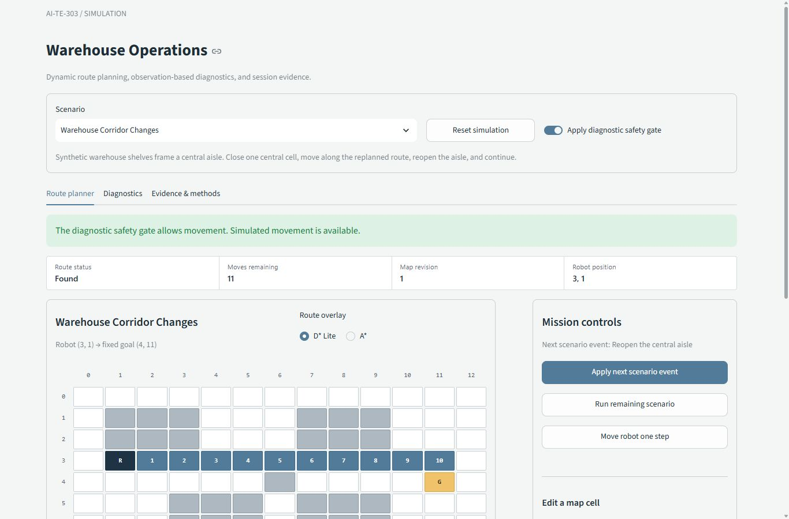

# AI-TE-303

**Warehouse Robot Diagnostics and Dynamic Route Planning**

[](https://github.com/sar1p/AI-TE-303/actions/workflows/tests.yml)

Release: [v0.1.2](https://github.com/sar1p/AI-TE-303/releases/tag/v0.1.2).
Submission / live demonstration: Tuesday, October 13, 2026, Asia/Jakarta.

A two-member Artificial Intelligence coursework project. D* Lite repairs a
warehouse robot's route after map changes and movement. Repeated A* provides a
baseline. A separate expert system uses external IF-THEN rules and forward
chaining to explain suspected robot faults and the observations supporting them.

## Implementation status

- Project layout, ownership, and module contracts: established.
- D* Lite, A*, validated maps, and independent search tests: implemented.
- Streamlit demonstration, scenario replay, benchmark exports, and diagnostic adapter: implemented.
- Expert system: validated external rule data, deterministic forward chaining,
  grounded explanations, unknown evidence, corrected observations, and an independent CLI.
- Diagnostic scope: nine categorical observations, eleven illustrative rules,
  six supported findings, and eight named scenarios.

See [PROJECT_PLAN.md](docs/PROJECT_PLAN.md) for scope and
[TEAMMATE_TASKS.md](docs/TEAMMATE_TASKS.md) for contribution history and the review/presentation handoff.

## Development setup

### Windows: automatic setup

The app runs locally on 64-bit Windows 10 or 11. You do not need to sign in to
try this public project. For a new laptop, open PowerShell and paste this whole
block. It puts the project in your `Downloads\AI-TE-303` folder; when Git is
installed it creates a clone with its history, and when Git is absent it
downloads a ZIP instead. The installer does not install Git. A valid existing
project folder is reused without pulling or overwriting it; an unrelated folder
at that path is rejected. The block then prepares the environment and opens the
app automatically.

```powershell
& {
    $ErrorActionPreference = 'Stop'
    [Net.ServicePointManager]::SecurityProtocol = [Net.SecurityProtocolType]::Tls12
    $installer = Join-Path $env:TEMP ('AI-TE-303-install-' + [guid]::NewGuid().ToString() + '.ps1')
    Invoke-WebRequest -UseBasicParsing 'https://raw.githubusercontent.com/sar1p/AI-TE-303/main/install.ps1' -OutFile $installer
    & powershell.exe -NoProfile -NonInteractive -ExecutionPolicy Bypass -File $installer
    if ($LASTEXITCODE -ne 0) { throw 'Setup failed. Check the message above.' }
}
```

If you downloaded the repository ZIP yourself, choose **Code > Download ZIP**
on GitHub and extract it, then double-click `run.bat` inside the extracted
folder.
You do not need Git or Python installed to run an extracted ZIP. First setup
needs an internet connection to download the runtime or packages as needed.

The launcher finds Python 3.12 or downloads a private runtime, creates the
project environment, installs the libraries, and opens the app in your default
browser. If port 8501 is busy, it chooses another local port. Later starts reuse
the environment. Keep the extracted project close to the top of Downloads to
avoid Windows errors caused by very long folder paths.

Keep the terminal open while the app is running and press Ctrl+C to stop it.
`run_demo.bat` remains available as a compatibility alias.
See [DEMO_GUIDE.md](docs/DEMO_GUIDE.md) for the live presentation sequence.

### Linux and macOS: automatic setup

Open Terminal and paste this whole block. It puts the project in
`~/Downloads/AI-TE-303`, prepares Python 3.12 and its libraries, and opens the
local app. Git and Python do not need to be installed first. Git is used when
available; otherwise the installer downloads the source archive.

```bash
(
    set -e
    installer="$(mktemp "${TMPDIR:-/tmp}/AI-TE-303-install.XXXXXX")"
    url=https://raw.githubusercontent.com/sar1p/AI-TE-303/main/install.sh
    if command -v curl >/dev/null 2>&1; then
        curl --fail --location --silent --show-error "$url" --output "$installer"
    else
        wget -q "$url" -O "$installer"
    fi
    bash "$installer"
)
```

For a ZIP download, extract it and open Terminal in the folder containing
`app.py`. Run just:

```bash
bash run.sh
```

The same command starts later sessions. No environment activation or `chmod`
command is needed. A macOS Git clone also includes an executable `run.command`
entry point; double-click it to open Terminal and start the app. For downloaded
ZIPs, extraction permissions and macOS file-opening rules can vary, so the
Terminal command above is the consistent path.

First setup needs internet. Keep the terminal open and press Ctrl+C to stop.
Existing project files and incompatible environments are preserved. The launcher
uses a suitable Python 3.12 or prepares a private runtime without changing system
Python or shell profiles. Modern glibc Linux and macOS 14+ are supported on
x86_64 and ARM64; Alpine/musl and 32-bit systems are outside this launcher.
The download block needs `curl` or `wget`; normal `tar` and SHA256 utilities are
also required. These are included in macOS and common desktop Linux installations.

### Developer checks

From the project folder:

- Prepare the runtime and dependencies without launching the app:

  ```powershell
  .\run.bat -SetupOnly
  ```

- Run pytest, then start the app:

  ```powershell
  .\run.bat -Verify
  ```

- Supply a specific validated Python 3.12 when creating the environment:

  ```powershell
  .\run.bat -Python "C:\Path\to\python.exe"
  ```

Runtime provenance, environment recovery, and launcher verification are in
[WINDOWS_LAUNCHER.md](docs/WINDOWS_LAUNCHER.md).

On Linux/macOS, the automatic launcher provides equivalent checks:

```bash
bash run.sh --setup-only
bash run.sh --verify
```

Use `--managed-python` when creating an environment to select a project-private
runtime even if Python 3.12 is installed. See [UNIX_LAUNCHER.md](docs/UNIX_LAUNCHER.md)
for runtime provenance, supported platforms, and native verification.

## Run without the interface

```powershell
.\.venv\Scripts\python.exe -m expert_system --scenario battery-multi-hop --output artifacts/battery-diagnosis.json
.\.venv\Scripts\python.exe -m expert_system --all --output artifacts/diagnostic-scenarios.json
.\.venv\Scripts\python.exe -m search_algorithm.main --output artifacts/single-replay.json
.\.venv\Scripts\python.exe tools/replay_demo.py --output artifacts/demo
.\.venv\Scripts\python.exe tools/combined_demo.py --output artifacts/combined-demo.json
.\.venv\Scripts\python.exe tools/benchmark_search.py --output artifacts/benchmark --repeats 5
```

Four synthetic scenarios cover a blocked/reopened aisle, movement with retained
search state, unreachable-goal recovery, and widespread map changes. Exports
contain actual inputs, computed routes, metrics, source SHA, and environment.
Development exports go to ignored `artifacts/`.

The diagnostic replay checks each named case against its explicit expected
status and conditions, including intentionally incomplete or invalid cases.
The combined replay demonstrates a battery inference chain, rejected movement,
map repair, corrected observations, and resumed movement with one retained
planner. Exports include the raw inputs and knowledge-base provenance/hash.

Verified running results, source metadata, real screenshots, and clean-clone
checks are in [docs/evidence/](docs/evidence/README.md).

The [completed-system snapshot](docs/evidence/completed-system-2026-10-11/README.md)
records 167 passing tests, eight matching diagnostic fixtures, an actual
pause/correction browser demo, and a silent screen recording from a clean clone.
The teammate's independent review and laptop rehearsal remain the human handoff.



## Why these methods

| Method | Role | Limits |
|---|---|---|
| D* Lite | Repair routes while the start moves toward a fixed goal and map connectivity changes | Initialization and extensive changes can cost more than reuse saves |
| A* | Fresh shortest-path baseline for the current map | Repeats search after each update |
| UCS / Dijkstra | Independent optimal-cost oracle in tests | Used for correctness, not the interactive planner |
| Forward-chaining expert system | Explain categorical observations through an inspectable rule chain, including power, drive feedback, and motor connection cases | Limited to declared observations and illustrative rules; no measured diagnostic accuracy |

The grid supports four-neighbor unit-cost movement. Weighted terrain, diagonal
motion, multiple robots, and physical control are outside this implementation.
See [SEARCH_ALGORITHM.md](docs/SEARCH_ALGORITHM.md) for algorithm details,
metric definitions, benchmark boundaries, and suitable/unsuitable uses.

The diagnostic safety gate requires a valid `ok` diagnosis without `pause_robot`
before allowing movement. A missing engine is shown as pending. The search-only
simulation remains independently usable. Adapter tests use synthetic contract
fixtures; separate engine, CLI, and Streamlit integration tests exercise the
actual rule data and correction behavior. `ok` means the supplied observations
are complete under this knowledge base, rather than a physical health or safety
certificate. See [EXPERT_SYSTEM.md](docs/EXPERT_SYSTEM.md) for supported
observations, inference semantics, suitable uses, and limitations.

The interface uses a restrained operations layout with separate route,
diagnostic, and evidence tabs. A guided observation draft and named presets
support the live demo; the advanced JSON input rejects ambiguous or non-finite
data. See [UI_DESIGN.md](docs/UI_DESIGN.md) for the design references and layout decisions.

## Collaboration

Use feature branches, tested commits, pull requests, and merge commits.
Each member uses their own account for their actual work.
See [CONTRIBUTING.md](CONTRIBUTING.md) and
[MODULE_CONTRACTS.md](docs/MODULE_CONTRACTS.md). New GitHub users can follow
[GITHUB_GUIDE.md](docs/GITHUB_GUIDE.md) for setup, commits, pushes, PRs, and recovery.

Completed expert-system implementation and verification are tracked in the closed
[issue #3](https://github.com/sar1p/AI-TE-303/issues/3). The teammate's
`zaedalmusthofa` account has collaborator access and an attributed starter commit.
That original commit remains in the main history. The lead completed the rule
engine expansion, tests, interface, and integration; those later changes use
the lead's identity. The teammate's next responsibility is review and rehearsal.

The classroom materials establish the assignment background. The warehouse
theme and advanced algorithm are this team's design choices. Simulation results
do not establish performance or diagnostic reliability on physical robots.

## Method reference

Sven Koenig and Maxim Likhachev, *D* Lite*, AAAI 2002.
[Primary paper](https://idm-lab.org/bib/abstracts/papers/aaai02b.pdf).
Implementation and experiment details are documented in the method guide and
versioned running evidence. Synthetic benchmark results do not establish a
universal speed advantage for D* Lite.
