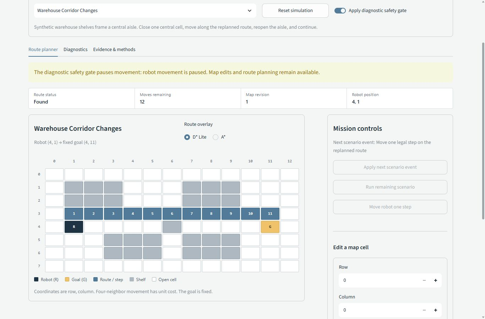
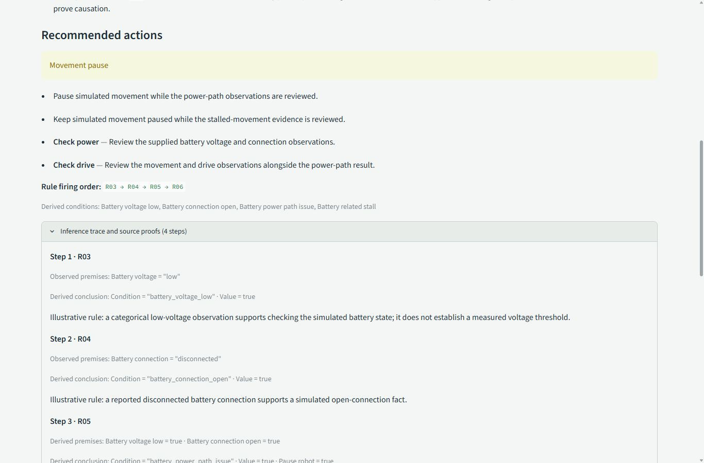

# Completed system: verified running evidence

Recorded source: [`118e95b`](https://github.com/sar1p/AI-TE-303/commit/118e95b50c2aa3196980435075a21ed6be789603),
merged through [PR #7](https://github.com/sar1p/AI-TE-303/pull/7).
Captured on October 11, 2026, Asia/Jakarta (UTC timestamps remain in the exports).
The remote clone and exported source worktree were clean. Python 3.12.14,
Streamlit 1.65.0, and pytest 9.1.1 ran on Windows 11. Publication changes only
documentation and recorded evidence; generated metadata identifies the actual
implementation revision that ran.

## Actual verification

- A fresh remote clone, a fresh virtual environment, and pinned installation
  succeeded. [Nine checks](clean-clone.json) exited zero; [pytest](tests.txt)
  reports **167 passed**. [Dependency consistency](dependencies.txt) passed.
- [Eight diagnostic fixtures](diagnostics.json) match their explicit expected
  statuses and findings. The aggregate includes an intentional invalid-input
  case. [The same replay with site packages disabled](diagnostics-stdlib.json)
  verifies that core diagnostics use the standard library.
- [The standalone battery CLI](battery-diagnosis.json) applies R03 and R04
  independently, then R05 from both derived facts, then R06 from the power-path
  finding and stalled movement. The trace order is R03, R04, R05, R06.
- [The headless combined demo](combined-demo.json) passed all seven checks:
  diagnostic pause, map edit while paused, rejected movement without mutation,
  fresh corrected inference, one permitted step, retained planner, and A* cost
  agreement.
- [Four search replays](replays/replay.json) produced 22 planning records.
  [Five benchmark repetitions](benchmark/summary.json) produced
  [110 paired measurements](benchmark/raw.csv).
- [Main CI](https://github.com/sar1p/AI-TE-303/actions/runs/38089401923) passed at the same implementation revision.
- [The contributor snapshot](contributors.json) confirms `sar1p` and
  `zaedalmusthofa`. The teammate's original commit `a57eebd8e93cb00a899ee792146707f96e750046` remains an
  ancestor of this source. The lead's expansion retains the lead's authorship.

## Actual browser demonstration

[Paused session](paused-session.json): gate enabled, two battery findings,
four fired rules, position `(4, 1)`, costs 10 then 12 after closing the central
aisle, and map revisions zero then one. Movement controls were visibly disabled;
map repair remained available.

[Corrected session](corrected-session.json): guided input changed movement to
`moving`, battery voltage to `normal`, and connection to `connected`. Fresh
inference returned no findings, trace, recommendations, or missing facts. The
next move reached `(3, 1)` with cost 11. Both algorithms report 10, 12, 11, and
the retained D* Lite planner initialization count is one throughout.

[Watch the actual silent browser recording](warehouse-demo.mp4)
(231.6 seconds, H.264, 1366 by 900). It contains actual browser frames
with their observed timing, including interaction pauses. [Capture metadata](browser-recording.json)
records all frame timestamps. The full encoded video was decoded without errors.
Raw JPEG frames remain in ignored local artifacts; the published video is not a
reconstructed screenshot sequence or a two-person presentation recording.

Wide (1366 px), medium (698 px), and narrow (420 px) layouts were inspected.
The narrow toolbar and diagnostic preset stack without clipped controls; the
warehouse grid deliberately keeps horizontal scrolling at small widths.
See [the narrow diagnostics screen](diagnostics-narrow.jpg) and
[the medium route screen](route-medium.jpg). Temporary viewport overrides were
reset after inspection.

## Measured search comparison

Times are milliseconds, medians over five repetitions. Repair totals and
cumulative totals are calculated within each repetition before aggregation;
separate phase medians do not necessarily add to the cumulative median.

| Scenario | D* Lite initial | A* initial | D* Lite repairs | A* repairs | D* Lite cumulative | A* cumulative |
|---|---:|---:|---:|---:|---:|---:|
| corridor-changes | 0.763 | 0.135 | 2.411 | 1.053 | 3.174 | 1.188 |
| movement-reuse | 5.061 | 0.987 | 3.227 | 7.377 | 8.288 | 8.319 |
| unreachable-recovery | 0.465 | 0.082 | 1.775 | 0.396 | 2.243 | 0.479 |
| widespread-changes | 30.145 | 6.217 | 4.851 | 12.453 | 35.210 | 18.664 |

These synthetic measurements do not establish a universal speed advantage.
D* Lite carries an initialization and bookkeeping cost; retained state can
reduce later repair work without necessarily reducing cumulative runtime.
The fixed D* Lite-first execution order and exact timing boundaries are in
[the raw summary](benchmark/summary.json) and [the method guide](../../SEARCH_ALGORITHM.md).
Search-only replays and benchmarks do not include diagnostic inference.

## Integrity and remaining human work

[Verification summary](verification.json) records checks and limits.
The raw knowledge-base file SHA-256 is `e293fc70b6dfdeacb1db32a8acba26885594ec3ddb1ef62ee0b8dc2d99286cc3`; the combined demo separately
labels its canonical JSON SHA-256 `94fea3927f742f24f99ca72d8988aafb48d27a59b57c2b6cf53540a032386146`. These represent different
serializations of the same rule data.

[SHA256SUMS.txt](SHA256SUMS.txt) covers every published artifact in this folder
except the manifest itself. Text artifacts use LF; screenshot and video bytes
are retained unchanged. Earlier evidence snapshots remain separate.

The teammate still needs to reproduce on their laptop, independently review
the rules and limitations, and rehearse the presentation with the lead. Those
human actions are not claimed by this software verification. All diagnostic
rules and observations are illustrative; no physical robot validation,
diagnostic accuracy, or safety certification is established.
