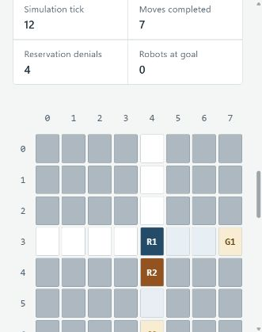
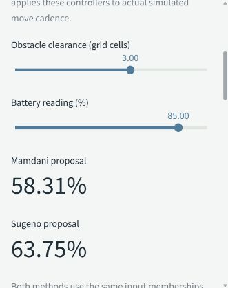

# Four-method running evidence

Recorded on October 19, 2026. The runtime outputs and UI export identify clean
source [`92edde2`](https://github.com/sar1p/AI-TE-303/commit/92edde2007ea5b0bfae90043353e0179a6eb2a90),
Python 3.12.14, Streamlit 1.65.0, and pytest 9.1.1 on Windows 11. Later evidence
publication and explanatory text changes do not replace this recorded revision.
The [verification record](verification.json) links each result to its source.

## What actually ran

| Check | Recorded result |
|---|---|
| Automated Python tests | 224 passed in the [Python CI job](https://github.com/sar1p/AI-TE-303/actions/runs/39230175788/job/117985964930); see the unchanged [summary line](ci-test-summary.txt) |
| CI for this PR head | Six successful jobs: Python tests, Windows launcher, Ubuntu x86_64/ARM64, and macOS ARM64/Intel; [actual run](https://github.com/sar1p/AI-TE-303/actions/runs/39230175788), [job records](ci-validation.json) |
| Integrated Mamdani replay | Both robots arrived in 19 simulation ticks; all six replay checks passed |
| Integrated Sugeno replay | Both robots arrived in 22 simulation ticks; all six replay checks passed |
| Per-robot diagnostic stop | R01 stayed still despite a positive fuzzy proposal; corrected observations permitted it to resume |
| Reused search state | Each robot retained one D* Lite planner initialization through its replay |
| Fuzzy comparison | 121 fixed input cases, five timing repetitions, and 1,210 individual API timing samples |
| Actual UI download | Fleet tick 12; R01 at `(3, 4)`, R02 at `(4, 4)`; source metadata reports a clean worktree |

The automated suite includes 30 deterministic maps with three robots and 20
ticks per map, plus map edits. It checks positions, edge swaps, cardinal
movement, paused/zero-speed behavior, fractional credit, and retained planners.
These bounded checks do not establish general deadlock freedom or physical
collision avoidance. The launcher matrix also checks first setup, reuse,
incomplete-source rejection, and recovery; its separate launcher tests are not
included in the 224 pytest count. The PR CI skips the default-Downloads
published-installer check until the normal main-branch workflow.

## Reproduce

From this recorded revision, after preparing the project environment:

```powershell
.\.venv\Scripts\python.exe -m pytest -q
.\.venv\Scripts\python.exe -m fuzzy_logic --clearance 3 --battery 85 --output artifacts/fuzzy-mamdani.json
.\.venv\Scripts\python.exe -m fuzzy_logic --method sugeno --clearance 3 --battery 85 --output artifacts/fuzzy-sugeno.json
.\.venv\Scripts\python.exe -m multi_agent_system --ticks 12 --output artifacts/multi-agent.json
.\.venv\Scripts\python.exe tools/fleet_demo.py --method mamdani --output artifacts/fleet-mamdani.json
.\.venv\Scripts\python.exe tools/fleet_demo.py --method sugeno --output artifacts/fleet-sugeno.json
.\.venv\Scripts\python.exe tools/benchmark_fuzzy.py --repeats 5 --output artifacts/fuzzy-benchmark
.\.venv\Scripts\python.exe -m streamlit run app.py --server.address 127.0.0.1
```

In the app, select **Fleet coordination**, then **Run 12 ticks** after a reset.
The recorded Mamdani session shows seven moves and four reservation denials.
Select **Fuzzy speed control** with clearance `3` and battery `85` to reproduce
the displayed Mamdani `58.31%` and Sugeno `63.75%` proposals. Download actual
state from **Evidence & methods**; tabs and downloads do not advance the fleet.

## Measurement boundaries

The local median elapsed API times were `0.8178 ms` for Mamdani and `0.0273 ms`
for Sugeno across this fixed input mix. These are measurements from an ordinary
shared Windows host without CPU isolation. Each call includes membership,
rule, and explanation construction; Mamdani also builds a 201-point aggregate
curve, while Sugeno has no fuzzy output set. File I/O and chart rendering are
excluded. Method order alternates by input case and repetition; each case has
untimed evaluations before measurement. Raw samples are preserved below.

The output meanings differ, and their different synthetic cadence explains
different replay tick counts. Neither elapsed time nor tick count establishes
which controller is more accurate or suitable for physical deployment. The
membership thresholds, grid clearance, battery readings, and fault rules are
illustrative. No measured robot data or physical actuation was used.
One-tick reservations may deadlock; CBS/ECBS, WHCA*, ANFIS, and Open-RMF remain
researched alternatives. See the [architecture review](../../ARCHITECTURE_REVIEW.md).

## Recorded files

- [verification.json](verification.json): source, CI, replay, benchmark, and UI checks.
- [ci-validation.json](ci-validation.json) and [ci-test-summary.txt](ci-test-summary.txt): actual GitHub job results and selected unchanged test log line.
- [fleet-mamdani.json](fleet-mamdani.json) and [fleet-sugeno.json](fleet-sugeno.json): crossing, diagnostic pause, correction, positions, messages, and calculation traces.
- [multi-agent.json](multi-agent.json): independent fleet CLI output.
- [fuzzy-mamdani.json](fuzzy-mamdani.json) and [fuzzy-sugeno.json](fuzzy-sugeno.json): independent controller CLI outputs.
- [session-ui.json](session-ui.json) and [fuzzy-ui.json](fuzzy-ui.json): actual browser downloads.
- [response-surface.csv](fuzzy-benchmark/response-surface.csv), [timing-samples.csv](fuzzy-benchmark/timing-samples.csv), and [summary.json](fuzzy-benchmark/summary.json): fixed inputs, every timing sample, source metadata, and measurement limits.
- [SHA256SUMS.txt](SHA256SUMS.txt): checksums of every other file in this snapshot. Text uses LF endings; screenshot bytes are unchanged.

The screenshots below show the actual narrow browser viewport. They do not
claim a complete page capture or a separate rehearsal on the teammate's laptop.




