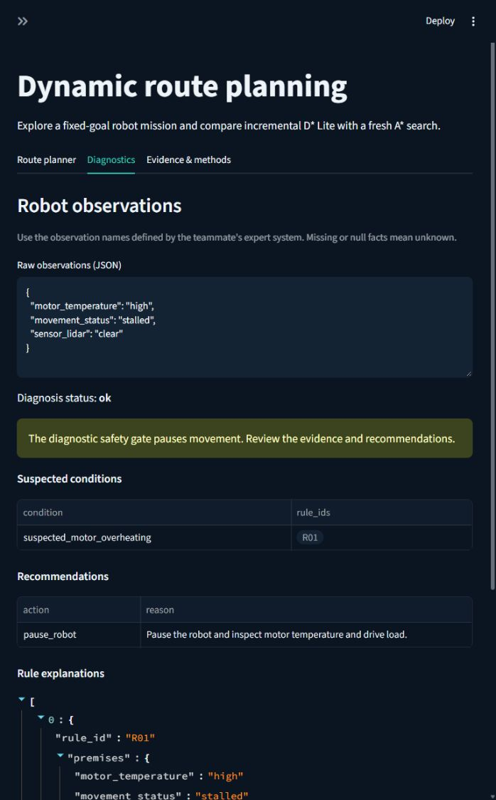
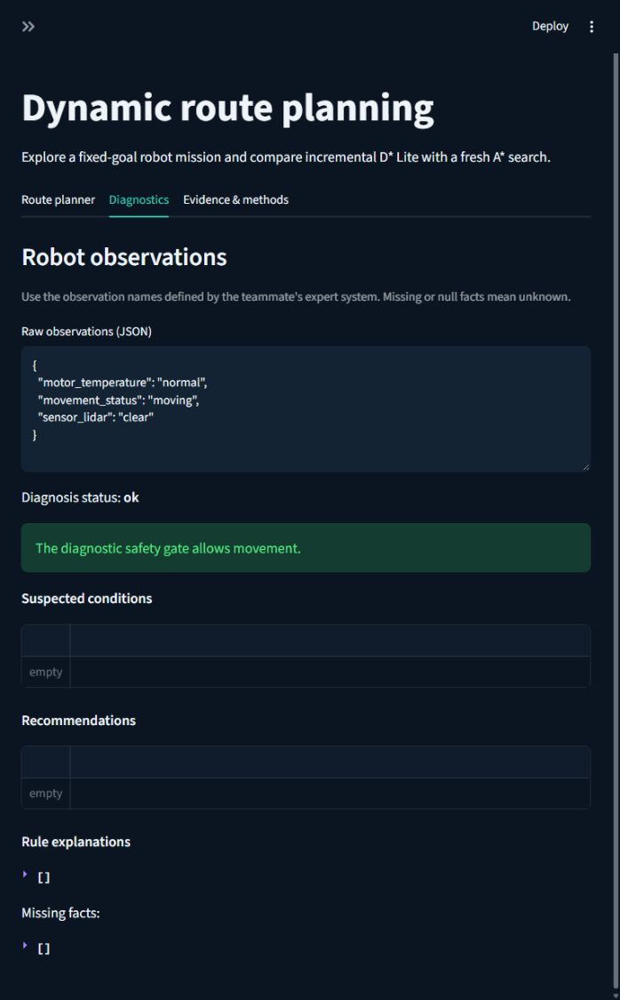
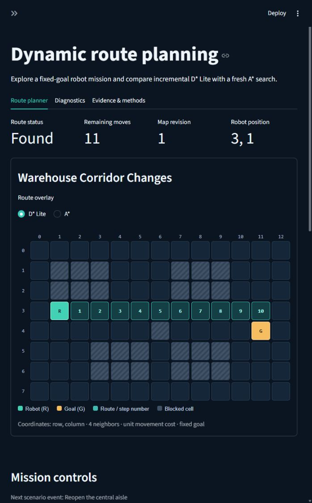

# Integrated starter: verified running evidence

Measured source: [`8e09254`](https://github.com/sar1p/AI-TE-303/commit/8e09254fac105335fd3ea5658f6e208de3cfc203),
the normal merge of [PR #5](https://github.com/sar1p/AI-TE-303/pull/5).
Recorded on October 11, 2026 in Asia/Jakarta; export metadata uses UTC and
therefore records October 10. The source was a fresh remote clone with a clean
worktree and a fresh virtual environment on Windows 11, using Python 3.12.14,
Streamlit 1.65.0, and pytest 9.1.1.

This snapshot covers search and the integrated **two-rule diagnostic starter**.
External rule data, genuine forward chaining, and an independent diagnostic CLI
remain pending. The evidence publication and guide changes occur after the
measured source and do not change its execution results.

## What was verified

- Dependency consistency, all **119 tests**, the search CLI, all four scenario
  replays, and a one-repetition benchmark completed successfully in the fresh
  clone. The five actual command outcomes are in [clean-clone.json](clean-clone.json).
- [Main CI](https://github.com/sar1p/AI-TE-303/actions/runs/38084422232)
  passed at the same source SHA. Selected actual log lines are preserved in
  [ci-validation.txt](ci-validation.txt).
- The replays produced 22 planning records. The benchmark produced 22 paired
  rows. This one-repetition benchmark verifies execution; it is not a repeated
  performance study. See the [historical five-repetition search snapshot](../README.md)
  and [measurement limits](../../SEARCH_ALGORITHM.md).
- Six diagnosis cases were checked against explicit expected outcomes, using
  the actual engine and adapter: missing observations, motor fault, lidar fault,
  simultaneous faults, corrected observations, and invalid values. See
  [diagnostic-cases.json](diagnostic-cases.json).
- The live browser showed `R01` and `pause_robot` for the motor case. Replacing
  the raw observations removed the obsolete finding and allowed simulated
  movement with the diagnostic gate enabled. Both actual session downloads
  are preserved below.
- The teammate's original commit
  [`a57eebd`](https://github.com/sar1p/AI-TE-303/commit/a57eebd8e93cb00a899ee792146707f96e750046)
  is an ancestor of measured `main`. The GitHub contributor API confirmed
  `sar1p` and `zaedalmusthofa` after the merge. [contributors.json](contributors.json)
  records that timestamped public snapshot; later contribution counts may change.

The original 90 tests did not exercise the actual starter engine. The repaired
integration adds 29 engine and interface checks, bringing the suite to 119.
The six exported cases are additional recorded demonstrations, not an extra
test count. No measured diagnostic accuracy is claimed.

## Actual browser cases

Paused observations:

```json
{"motor_temperature":"high","movement_status":"stalled","sensor_lidar":"clear"}
```

The result is `ok`, with `suspected_motor_overheating`, rule `R01`, and
`pause_robot`. The gate is enabled. See [paused-session.json](paused-session.json).



Corrected observations:

```json
{"motor_temperature":"normal","movement_status":"moving","sensor_lidar":"clear"}
```

The result is `ok` with empty findings, trace, recommendations, and missing facts.
The enabled gate allows movement according to the starter's simulation policy.
This does not certify physical robot health. See
[corrected-session.json](corrected-session.json).



The corrected session then closes the central aisle and moves the robot one
legal cell. The two planners agree on the costs below:

| Event | Robot position | Map revision | D* Lite cost | A* cost | Initializations | k_m |
|---|---|---:|---:|---:|---:|---:|
| Initial planning | 4, 1 | 0 | 10 | 10 | 1 | 0 |
| Block the central aisle | 4, 1 | 1 | 12 | 12 | 1 | 0 |
| Move one legal step | 3, 1 | 1 | 11 | 11 | 1 | 1 |



The original session export's `scope` field labels the route-planning record
stream as search-only; its `diagnostics` object separately records the real
diagnostic result, raw observation text, adapter status, and gate setting.
Replay and benchmark artifacts evaluate search alone and do not run diagnosis.

## Files and reproducibility

| File | Contents |
|---|---|
| [clean-clone.json](clean-clone.json) | Measured source, environment, five actual command outcomes |
| [clean-clone-tests.txt](clean-clone-tests.txt) | Actual 119-test output |
| [dependencies.txt](dependencies.txt) | Actual dependency consistency output |
| [search-cli.txt](search-cli.txt), [single-replay.json](single-replay.json) | Search CLI output and computed result |
| [scenario-replay.txt](scenario-replay.txt), [replay.json](replay.json) | All four scenario replays |
| [benchmark.txt](benchmark.txt), [benchmark-raw.csv](benchmark-raw.csv), [benchmark-summary.json](benchmark-summary.json) | Actual one-repetition search benchmark |
| [diagnostic-cases.json](diagnostic-cases.json) | Six actual diagnosis/adapter outputs |
| [paused-session.json](paused-session.json), [corrected-session.json](corrected-session.json) | Actual browser downloads before and after correction |
| [ci-validation.txt](ci-validation.txt) | Selected main CI log lines and source SHA |
| [contributors.json](contributors.json) | Public contributor snapshot and preserved teammate commit |
| [SHA256SUMS.txt](SHA256SUMS.txt) | Checksums for this snapshot's files |

The three JPEG images were captured from the running application. Text artifacts
are stored with LF line endings for reproducible checksums; JSON values, recorded
measurements, and screenshot bytes were not rewritten. Original exports remain
in the lead's ignored local validation folder.

Use [DEMO_GUIDE.md](../../DEMO_GUIDE.md) to repeat the live sequence and setup.
For exact source reproduction, clone the repository into a new folder and use
`git switch --detach 8e09254fac105335fd3ea5658f6e208de3cfc203` before following
the setup and verification commands. Detached mode is suitable for reproduction;
create a feature branch from current `main` for new development.

## Remaining team deliverables

The expanded expert system is tracked in
[issue #3](https://github.com/sar1p/AI-TE-303/issues/3). A real screen recording
and the final fresh-clone rehearsal on the teammate's laptop are still required.
This lead-side clean-clone check does not establish that the teammate's laptop
has been configured or that the full forward-chaining engine is complete.
